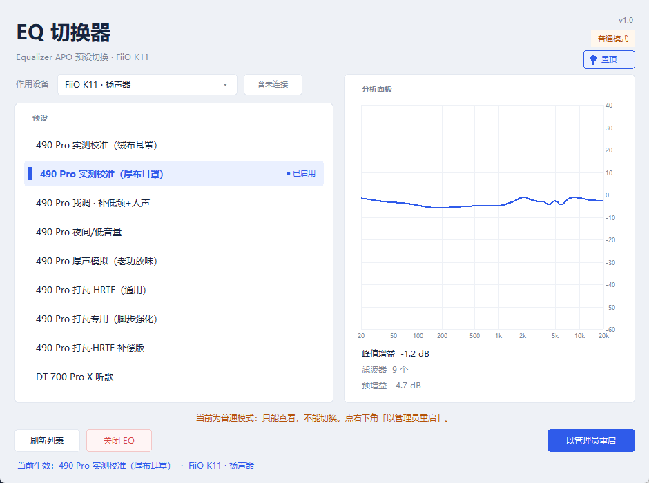

# EQ 切换器（Equalizer APO Preset Switcher）

一键切换 Equalizer APO 预设的 Windows 小工具，浅色卡片界面，带实时频响分析面板。



## 功能

- 自动读取 `F:\int\eq` 下的 `*.txt` 预设，点击即切换
- 显示当前生效的预设，切换时自动备份 `config.txt`
- 右上角置顶开关（状态保存）
- **作用设备**下拉：只对选中的播放设备生效（写 `Device:` 行），支持显示未连接设备
- **分析面板**：按预设计算 20 Hz–20 kHz 频响曲线、峰值增益、滤波器数量、预增益
- 预设列表超过可视高度时自动出现滚动条
- 非管理员模式只读，提示以管理员重启

## 界面

```
┌────────────────────────────────────────────────────┐
│ EQ 切换器                              v1.0 管理员  │
│ Equalizer APO 预设切换 · FiiO K11          [置顶]  │
│ 作用设备 [FiiO K11 · 扬声器 ▾]  [含未连接]         │
├──────────────────────────┬─────────────────────────┤
│ 预设                     │ 分析面板                │
│ ● 490 Pro 实测校准（绒布）│      __/\__             │
│   490 Pro 实测校准（厚布）│  ___/      \___         │
│   490 Pro 我调 · 补低频    │                         │
│   ...                    │ 峰值增益 -0.1 dB        │
│                          │ 滤波器 8 个             │
│                          │ 预增益 -5.5 dB          │
├──────────────────────────┴─────────────────────────┤
│ [刷新列表] [关闭 EQ]              [以管理员重启]   │
│ 当前生效：490 Pro 实测校准（绒布耳罩）· FiiO K11   │
└────────────────────────────────────────────────────┘
```

## 运行要求

| 项 | 说明 |
|---|---|
| 系统 | Windows 10 / 11 |
| 依赖 | Equalizer APO 已安装（默认 `C:\Program Files\EqualizerAPO`） |
| 预设目录 | `F:\int\eq`，每行一个 APO 配置文件 |
| 权限 | 切换配置需要管理员（exe 已带 `requireAdministrator` 清单） |

路径写死在源码顶部，换机器需要改：

```python
EQ_DIR = r"F:\int\eq"
APO_DIR = r"C:\Program Files\EqualizerAPO\config"
```

## 使用

1. 双击 `EQ切换器.exe`，UAC 点「是」
2. 选作用设备（默认全部设备）
3. 点预设切换
4. 右侧曲线会跟着当前预设刷新

首次运行如果出现 SmartScreen：「更多信息」→「仍要运行」（未签名）。

## 从源码运行

```powershell
python eq-switcher.py
```

只依赖标准库 `tkinter`，无需安装第三方包。

## 编译 exe

```powershell
python -m pip install pyinstaller
python -m PyInstaller --onefile --noconsole --uac-admin ^
  --name "EQ切换器" --icon eq.ico --add-data "eq.ico;." ^
  --distpath dist --workpath build --specpath build eq-switcher.py
```

或直接运行 `build_exe.bat`。

## 说明

- 分析曲线是按预设文本计算的近似值（RBJ biquad），不读取 APO 运行时状态
- `GraphicEQ` / `Convolution` 暂不纳入计算
- 切换配置会先备份为 `config.bak-日期-时间.txt`
- `ui_state.json` 保存置顶状态

## License

MIT
